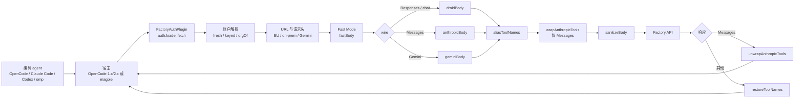

# Factory 插件详细设计

> 适用版本：`factory/package.json` 0.1.58
> 代码基线：官方 factory 0.1.57（upstream 提交 `261cdc0b0964`），叠加本地 Codex/omp/guardian 兼容修复
> 面向读者：插件维护者、magpie/OpenCode 集成开发者  
> 使用说明：见 [`../factory/README.md`](../factory/README.md)。本文描述内部结构、请求管线与设计取舍。

## 1. 目标

Factory（Droid）订阅只愿意服务 Droid 自己发出的模型请求。这个插件的目标不是“把 Factory 伪装成通用 OpenAI 代理”，而是：

1. 让 OpenCode、magpie 以及其他编码 agent 能用同一个 Factory 订阅；
2. 让请求在认证、组织、模型目录和 wire 形状上尽可能接近 Droid；
3. 只改写 Factory 明确拒绝的固定客户端元数据，保留用户任务、历史、工具定义和文件内容；
4. 在 Factory 的策略、请求体上限或工具 schema 兼容性发生变化时，给出可诊断、可操作的错误，而不是静默失败。

## 2. 非目标

- 不绕过 Factory 的计费、配额、组织权限或内容政策；插件只做协议兼容。
- 不把 Factory 的模型能力转售给其他人；订阅仍按账号使用。
- 不压缩图片、不截断用户文本、不做摘要；413 时只按协议丢弃附件并把事实告诉调用方。
- 不实现本地推理、模型路由或额度计算；这些由 magpie 的 provider/gateway 层负责。
- 不保证任意第三方 agent 的任意提示词都能通过 Factory 的检查。内容政策是上游行为，插件只能处理已知的固定触发字符串。

## 3. 运行环境与约束

Factory 的订阅请求有三个硬约束，整个设计围绕它们展开：

1. **客户端身份**：请求必须看起来来自 Droid。Droid 的系统提示以固定行开头，并使用固定的客户端头。
2. **内容政策**：Factory 的检查读取整段对话。固定客户端提示、工具输出中引用的提示、压缩摘要、系统提醒等都可能触发 403 `content_policy_rejected`。
3. **请求体字节上限**：超过上限返回 413 `Request Entity Too Large`。这是 body 字节数限制，不是模型上下文窗口；图片和大段工具输出会先撞上它。

此外，不同模型走不同 wire：

| wire | Factory 路径 | 典型模型 |
|---|---|---|
| Anthropic Messages | `/api/llm/a/v1/messages` | Claude、MiniMax M2.7 |
| OpenAI Responses | `/api/llm/o/v1/responses` | GPT、Grok |
| OpenAI chat completions | `/api/llm/o/v1/chat/completions` | GLM、Kimi、DeepSeek、Qwen、Mistral、Nemotron 等 |
| Gemini generateContent | `/api/llm/g/v1/generate` | Gemini 系列 |

插件必须在四种 body 形状上分别定位文本、工具、附件和响应事件。

## 4. 总体架构



### 4.1 组件职责

| 组件 | 职责 |
|---|---|
| `FactoryAuthPlugin` | 向宿主暴露 provider/config/auth 三个面；持有进程级刷新锁和 token 缓存 |
| `account()` | 读取当前账号，处理 API key、OAuth 刷新、组织修复、用量读取 |
| `auth.loader.send()` | 单次请求的完整适配管线 |
| `auth.loader.fetch()` | 负责 413、403、lapse 等状态的重试与错误翻译 |
| `droidBody()` | OpenAI 形状的系统提示、工具输出和 Fast Mode 适配 |
| `anthropicBody()` | Anthropic Messages 的固定元数据适配 |
| `geminiBody()` | Gemini 的 systemInstruction、模型字段和短语转义 |
| `aliasToolNames()` | 被拒工具名映射到 Droid 名称或进程内稳定后缀，以及回复侧还原 |
| `wrapAnthropicTools()` | 根级 `anyOf/oneOf/allOf` schema 的 `arguments` 包装 |
| `sanitizeBody()` | 离开插件前的最后一遍全文短语转义 |
| `client-phrases.json` | 固定文本短语的来源；`tool-names.mjs` 独立维护工具名规则 |

## 5. 入口与宿主适配

### 5.1 文件入口

| 文件 | 作用 |
|---|---|
| `factory/index.mjs` | 主实现；导出 `FactoryAuthPlugin` 和测试用的 `_internal` |
| `factory/opencode.mjs` | OpenCode 1.x / magpie 的入口，只 re-export `FactoryAuthPlugin` |
| `factory/opencode2.mjs` | OpenCode 2.x 适配层，默认导出 `{ id, setup(ctx) }` |
| `factory/anthropic-tools.mjs` | Anthropic schema 包装与回复解包 |
| `factory/tool-names.mjs` | 各 wire 的工具名别名、回复还原与流式处理 |
| `factory/client-phrases.json` | Factory 拒绝的固定文本短语 |

`package.json` 的 `files` 只发布运行需要的文件；测试和 `testdata/` 留在仓库中。包没有运行时依赖，使用 Node 内置 `fetch`、`Headers`、`Response`、`Buffer` 和 `node:http`。

### 5.2 宿主 hook 映射

`FactoryAuthPlugin` 返回的对象按 magpie 的形状组织：

```js
{
  provider: { id: "factory", models(provider) },
  config(config),
  auth: {
    provider: "factory",
    methods: [...],
    options: [...],
    refreshLead,
    rotating: true,
    refresh(auth),
    usage(getAuth),
    loader(getAuth),
  },
}
```

`auth.loader(getAuth)` 返回 `{ apiKey: "placeholder", fetch(input, init) }`。宿主把该 `fetch` 作为 AI SDK 的 transport；插件因此能在不修改 agent 的前提下接管请求。

OpenCode 1.x 直接加载 `FactoryAuthPlugin`。OpenCode 2.x 的 `opencode2.mjs` 负责：

- 把 1.x 的命名导出转换成 2.x 的默认 `{ id, setup }`；
- 把 `auth.methods`、`config()`、`provider.models`、`auth.loader` 映射到 2.x 的 context；
- 用 `packageOf()` 把 `@ai-sdk/*` 包名映射到 2.x 可加载的 `aisdk:` 名称；
- 丢弃 2.x 没有对应位置的 `chat.headers`、`chat.params`、usage、tools、events 等 hook。

## 6. 模型目录

### 6.1 静态目录的原因

Factory 没有稳定的公开模型列表接口；模型、wire、上下文、输出、reasoning effort、图片支持和倍率都来自 Droid 的注册表。插件因此把模型目录静态放在 `index.mjs` 的 `MODELS` 数组中，并用 `factory/testdata/droid-*` 的抓取结果做契约测试。

每项形状：

```js
[id, name, wire, upstream, context, output, efforts, images, rate]
```

- `wire`：`ANTHROPIC`、`RESPONSES`、`CHAT`、`GEMINI` 之一；
- `upstream`：`anthropic`、`openai`、`xai`、`google`、`fireworks`、`baseten`、`mistral` 等，用于 `x-api-provider` 和 Droid Core 归属；
- `efforts`：该模型允许的 reasoning 档位；
- `images`：是否接受图片；
- `rate`：Droid 注册表里的 token multiplier，不是美元价格。

`README.md` 的模型表是用户视图；`MODELS` 是唯一实现来源。

### 6.2 OpenCode 形状与 magpie 形状

同一个模型有两种投影：

- `configModels()`：OpenCode `provider.models` 的形状，包含 `provider.npm`、`provider.api`、`variants`、`limit`、`attachment`、`tool_call` 等；
- `providerModel()/providerModels()`：magpie 的 provider hook 形状，额外携带 `rate`、`rateWas`、`capabilities` 和 `api.url`。

`config()` 会把 `configModels()` 与宿主已有 `was.models` 合并，允许用户覆盖；`provider.models` 每次读取时重新计算，确保促销价和选项变化立即生效。

### 6.3 分组选项

`group_models_by_company` 是 magpie 的插件选项，默认关闭。关闭时保持 `MODELS` 的原始顺序；开启时：

- 按模型厂商分组（Anthropic、OpenAI、Google、其他），而不是按 API 托管商；
- 同一 family 内新版本在前；
- Fast Mode 紧跟其 base 模型；
- 没有匹配 family 的模型排在最后。

这样做的原因是 magpie 只展示 provider 的前 24 个模型；如果 Fast Mode 插在 base 旁边，会把后面的常用模型挤出首屏。

### 6.4 Fast Mode

Fast Mode 模型是 base 模型加上更高的倍率。`fastBody(path, body)` 处理两种入口：

- 请求直接指定 `*-fast` 模型：保持模型 id，Anthropic 加 `speed: "fast"` 和 `fast-mode-2026-02-01` beta，Responses 加 `service_tier: "priority"`；
- 请求指定 base 模型但要求 fast（Claude Code 的 `speed: "fast"`、Responses 的 `service_tier: "priority"`）：把模型改成对应的 Fast id，再按上面的规则发送。

如果请求本身已经是 Fast 形状，函数返回原文，避免重复加 beta。

### 6.5 促销与倍率

`PROMOTIONS` 保存 Droid 注册表的促销窗口。`rateOf()` 在窗口内把 `rate` 乘以折扣，并把原倍率放进 `rateWas`；窗口外只返回原倍率。magpie 用 `rate` 显示倍率，用 `rateWas` 显示划线价。

## 7. 认证与账户生命周期

### 7.1 设备码登录

`deviceSignIn()` 走 WorkOS 的 device flow，使用 Droid 的 client id：

1. `POST /authorize/device` 拿 `device_code`、`user_code`、`verification_uri_complete`；
2. 返回 `url` 和 `instructions`，由宿主打开浏览器；
3. 轮询 `/authenticate`，处理 `authorization_pending`、`slow_down`、`expired_token`、`access_denied`；
4. 成功后 `signedInWith()` 解析 JWT、补组织、问 `whoami`，返回宿主可保存的账号对象。

`signedInWith()` 的关键点：

- 当 `c.orgId` 为空（`/authenticate` 的 `organization_id` 与 JWT 的 `org_id` 都没有）且 JWT 也没有 `external_org_id` 时，先 `GET /api/cli/org` 取第一个 org，再用 `renew(refresh, org)` 把 token 放进该 org；
- `whoami` 给出 `activeOrganizationId`、`region`、`premBaseHostV2`、`email`、`userId`；
- `accountId` 优先 email，其次 userId；
- 组织或 whoami 失败时尽量保留已有身份，但不允许“登录成功却不知道是谁”的账号。

### 7.2 API key

`fk-…` key 作为 bearer 直接发送，不刷新、不带组织头。`keyAccount()` 把它映射成账号对象；`keyed()` 会在首次使用时问 `whoami`，把 email、userId、region、host 写回 key 的 metadata，之后 `ASK_AGAIN` 内不再重复问。

### 7.3 刷新并发

WorkOS 会轮换 refresh token，同一枚 refresh token 不能被花两次。插件用三层保护：

1. `lock`/`locked()`：把检查、刷新、保存串行化；
2. `renewed` Map：按“被花掉的 refresh token”记录新 token 对；
3. `latest()`：如果宿主还没保存新 token，沿 `renewed` 链最多追 16 跳，拿到本进程已经得到的更新 token。

`auth.refresh` 是 magpie 的主动刷新 hook，提前 `MAGPIE_LEAD`（3 分钟）执行；`fresh()` 是请求前的被动检查，提前 `REFRESH_LEAD`（2 分钟）。两者共用同一把锁和同一张 `renewed` 表。

### 7.4 lapse 与组织修复

- `refused(e)`：WorkOS 4xx 且不是 429，说明 refresh token 被永久拒绝；
- `lapsed()`：把账号标记为过期，错误带 `lapsed: true`、`signIn: "expired"`；
- `mendOrg()`：Factory 403 且提示 active organization 不可访问时，清空 org、重新 `whoami`，或在无 org 时用 `firstOrg + renew` 把 token 放进第一个 org；
- 修复后只重发一次，避免 403 循环。

### 7.5 用量

`auth.usage(getAuth)` 请求 `GET /api/billing/limits`，把结果转成 magpie 的窗口：

- Standard 5 小时、7 天、30 天；
- Droid Core 的三个窗口；
- Extra usage 余额（分转美元，按 Go 的舍入方式）。

`limitWindows()` 决定路由语义：

- 默认：Standard 计付费厂商模型，Core 计开放模型；有 Extra usage 时窗口标记 `aside`，不阻止路由；
- `standard_only`：Standard 窗口计所有模型，Core/Extra 只展示；任一 Standard 窗口用尽就应跳过该账号。

`standard_only` 每次读取用量时从 magpie 选项读取，不需要重启；实际跳过账号仍依赖 magpie 的 account-cap。

## 8. 请求管线

### 8.1 `auth.loader.send()`

`send()` 是纯适配层，按固定顺序执行：

1. **取账号**：`fresh()` 返回可用 token；API key 走 `keyed()`，OAuth 走 `orgOf()`/刷新。
2. **改 URL**：
   - Gemini 的 AI SDK 路径 `/models/<id>:streamGenerateContent` 改成 Factory 的 `/generate`，清空 query；
   - org 的 `premBaseHost` 或 EU region 替换 `https://api.factory.ai` 前缀；
3. **构造请求头**：复制调用方 headers，删除 `x-api-key`、`x-goog-api-key`，再写 Droid 头；
4. **Fast Mode**：`fastBody()` 可能改 model、加 `speed`/`service_tier` 和 beta；
5. **确定 upstream**：从 body 的 model 查 `MODELS`；查不到时，`/llm/o/` 视为 openai，其他视为 anthropic；
6. **协议适配**：
   - Messages：`anthropicBody(body)`；
   - Responses/chat：`droidBody(path, body)`；
   - Gemini：URL 阶段已经 `geminiBody()`；
7. **工具名别名**：`aliasToolNames(body, every)`；遇到新的工具名拒绝时，同一工具集合后续可使用 `every` 全量改名；
8. **Anthropic schema 包装**：`wrapAnthropicTools()`；
9. **最后转义**：`sanitizeBody()`；
10. **发送**：`fetch(url, { ...init, headers, body })`；
11. **响应还原**：Messages 用 `unwrapAnthropicTools()`，其他用 `restoreToolNames()`。

只有 body 实际变化时才删除 `content-length`；未变化的 body 尽量保持原字节，避免破坏大整数、签名或调用方的字节级契约。

### 8.2 请求头

| header | 值/来源 | 说明 |
|---|---|---|
| `Authorization` | `Bearer <access 或 fk-key>` | OAuth 或 API key |
| `X-Factory-Client` | `cli` | Droid 客户端标识 |
| `X-Client-Version` | `0.242.0` | 兼容 Droid 的版本字符串 |
| `User-Agent` | `factory-cli/0.242.0` | 同上 |
| `X-Factory-Org-Id` | 账号 active org | 无 org 时删除 |
| `x-api-provider` | 模型的 upstream | 如 anthropic/openai/fireworks |
| `x-session-id` | 会话与 subagent 派生的 UUID | 同一 conversation 稳定，不同 conversation/subagent 隔离 |
| `x-assistant-message-id` | 每请求 UUID | |
| `x-provider-routing-source` | `registry_default` | 与 Droid 的默认上游一致 |
| `OpenAI-Platform` | 固定 org 标识 | 仅 OpenAI upstream |
| `X-Api-Key` | `placeholder` | 仅 Anthropic 路径，模拟 Droid 的 SDK |

### 8.3 响应错误

`fetch()` 负责状态级行为：

- **413**：见第 12 节；
- **403 content_policy_rejected**：不再重试，翻译成 400 `invalid_request_error`，保留 Factory 的 code；
- **403 其他**：先尝试组织修复；仍失败则 `permission_error`；
- **lapse**：502 `api_error`，并标记账号过期；
- 所有响应都带 `X-Magpie-Sign-In: renewed|kept|expired`，magpie 读取后删除该头。

## 9. Droid 身份与固定短语

### 9.1 系统提示开头

Factory 只接受以 Droid 固定行开头的系统提示：

```text
You are Droid, an AI software engineering agent built by Factory.
```

`clientOpening()` 在任意行的行首识别并替换以下固定开头：

| 来源 | 被拒形式 | 替换为 |
|---|---|---|
| pi | `You are an expert coding assistant operating inside pi, a coding agent harness.` | `You are an expert coding assistant.` |
| omp | `You are omp's trusted coding assistant.` | `You are a trusted coding assistant.` |
| Codex GPT-6 | `You are Codex, an agent based on GPT-6.`（句号可省略） | `You are a coding agent based on GPT-6.` |
| Codex CLI | 两句连写：`You are a coding agent running in the Codex CLI, a terminal-based coding assistant. Codex CLI is an open source project led by OpenAI.` | `You are a coding agent running in the Codex CLI.` |

只替换固定开头，后续提示原样保留。`droidBody()` 对 Responses 的 `instructions` 还会调用 `promptText()`，确保 DROID_LINE 在最前；对 Codex 0.170 把系统提示放在 `input[0]`、role `developer` 的情况，调用 `clientOpening()` 和 `guardianRestrictions()`，不把开发者输入当系统提示整体改写。guardian 审查提示中的 `You have no network access.` 改写为 `Network access is unavailable.`，保留只读和权限限制的语义。

### 9.2 短语分层

`client-phrases.json` 把短语分成两层：

- `anywhere`：在任意文本中都可能被拒（pi/omp/Codex 开头、pi compaction 开头）。这些短语在正文里也会被转义。
- `toolOnly`：只在工具输出里被拒（Claude 身份、环境句、billing header、压缩续写句、全局指令短语）。提示词适配器会改写这些固定元数据，工具输出则用无损编码。
- 工具声明名不属于文本短语清单，由 `tool-names.mjs` 单独维护。见第 11 节。

`loadClientPhrases()` 在 JSON 缺失或任一组为空时回退到内置 `FALLBACK_PHRASES`，避免文件损坏导致保护静默消失。

### 9.3 无损引用

工具输出可能引用被拒短语（例如读取插件源码、历史会话 JSONL、另一个 agent 的 system prompt）。插件不删除、不替换这些内容，而是：

1. 用 `JSON.stringify(text)` 得到可逆的 JSON 字符串；
2. 把命中的短语首字符转成 Unicode 转义；
3. 加前缀 `Tool output encoded as a JSON string. Decode the JSON string to recover the exact original text before using it:`；
4. 调用方解码后得到逐字节一致的原文。

`quotedToolText()` 负责工具输出；`escapePhrases()` 用于任意文本（不加包装）；`escapeDeep()` 遍历整个 JSON；`sanitizeBody()` 是最后一道兜底。转义按短语长度降序执行，避免短前缀先命中、长句后失效。

### 9.4 只改生成式元数据

适配器遵循“只改完整、可识别的生成式文本”原则：

- 完整的 `<system-reminder>` 环境块才改；
- 用户自己粘贴的同一句话不改；
- 不完整的提醒、hook 自己的输出、fenced code、引用片段不改；
- 工具结果里的固定短语走无损编码，而不是语义替换。

这是为了避免误改用户任务和对话历史。代价是：如果 Factory 将来拒绝一个新的、未列入清单的短语，插件不会自动猜出来，必须更新清单。

## 10. Anthropic Messages 适配

### 10.1 system 归一化

`anthropicBody()` 把 `system` 统一成 block 数组：

- 空 text block 删除；
- `x-anthropic-billing-header:` 行删除，但保留同一 block 中其后的指令（例如 auto-mode classifier policy）；
- 每个 text block 走 `promptText()`；
- 确保 DROID_LINE block 在最前；
- 删除重复的、仅含 DROID_LINE 的 block；
- 如果 DROID_LINE 与指令被网关合并成一个 block，只把固定身份行视为元数据，后续指令保留。

### 10.2 运行时元数据

Claude Code 会以多种形状发送同一批元数据：

| 形状 | 处理 |
|---|---|
| `<system-reminder>` 环境块 | `# Environment` → `# Runtime context`；`You have been invoked in the following environment:` → `The session environment is:` |
| 模型提醒 | `You are powered by the model named` → `Current model name:` 等 |
| 技能列表 | 只改 `update-config` 条目里的 `not Claude` → `not the assistant` |
| 压缩摘要 | 识别两种固定开头，只改第一句；引用部分走无损编码 |
| 恢复的 Read / 省略文件 | 改固定 header，保留参数和文件内容 |
| 变更文件提醒 | 只编码带行号的 snippet，保留路径和说明 |
| 全局指令提醒 | `(user's private global instructions for all projects)` → `(global instructions)` |
| 启动 hook / deferred tools | 保留 hook 输出和工具公告，只适配其后的环境块 |

`promptText()` 的组合顺序是：

```js
harnessText(
  configSkillText(
    guardianRestrictions(
      clientOpening(
        systemModelLine(
          claudeIdentity(
            claudeEnvironment(
              zcodeRuntimeContext(text)
            )
          )
        )
      )
    )
  )
)
```

`systemMessageText()` 用于第一个 system block 之后的 system 消息，组合为：

```js
harnessText(bareSkills(guardianRestrictions(clientOpening(systemContext(zcodeRuntimeContext(text))))))
```

`harnessText()` 还把客户端提示、工具描述和技能目录中的独立单词 `harness` 改为 `runtime`，但不改用户正文、工具输出或标识符中的该词。

### 10.3 用户消息与工具结果

- 字符串 user 消息：`compactContext()` → `instructionsText()`；
- text block：`userBlockText()`，处理压缩、指令提醒、hook/env、模型提醒、技能提醒；
- 一个 chat 请求把多个 block 拼成一个字符串时，`userText()` 会先整体适配，再逐个 `<system-reminder>` 块适配；
- `tool_result` 的字符串或 text part 走 `quotedToolText()`，保留 tool id、cache/error 标记和非文本 block。

### 10.4 其他字段

- 所有工具声明的 `defer_loading` 字段删除；Factory 拒绝 `defer_loading: true`，而该字段对模型没有语义。
- `stream: true` 时删除 `context_management`；Factory 的流式路由拒绝该字段，非流式路由接受。删除后由客户端自己的 compaction 负责上下文。
- `/messages/count_tokens` 走同一套适配，保证计数看到的是真正发送的提示。
- 无变化时返回原始 body，避免 JSON 往返改变大整数或字节内容。

## 11. 工具兼容

### 11.1 schema 包装

Factory 的 Anthropic 路由拒绝根级 `anyOf`、`oneOf`、`allOf`。`wrapAnthropicTools()` 不删除分支约束，而是把原 schema 放进一个内部参数：

```json
{
  "type": "object",
  "properties": {
    "arguments": { /* 原 schema */ }
  },
  "required": ["arguments"],
  "additionalProperties": false
}
```

配套处理：

- 本地 `$ref`/`$dynamicRef` 重写到 `#/properties/arguments/...`；
- 带 `$id` 的资源保持自己的解析作用域；
- `$recursiveAnchor`/`$recursiveRef` 且没有 `$id` 的递归 schema 直接报错，因为包装会改变作用域；
- `input_examples` 和历史 `tool_use.input` 也包进 `arguments`；
- 回复和下一轮历史中的 `arguments` 再解包，调用方看不到这层 envelope；
- 流式工具参数在 content block 完成前缓冲，避免半截 JSON 被解包。

该包装只用于 Anthropic Messages；OpenAI 路由不改 schema。

### 11.2 工具名别名

Factory 会拒绝某些工具声明名（`read`、`bash`、`edit`、`write`、`glob`、`grep`、`web_search`、`task`、`Agent` 等），清单会变化。`tool-names.mjs` 的 `aliasToolNames()`：

1. 读取请求声明的工具，按声明顺序选择别名；
2. 优先使用 Droid 的对应工具名，例如 `read` → `Read`、`bash` → `Execute`、`write` → `Create`、`Agent` → `Task`；
3. 没有对应 Droid 名称或名称冲突时，使用进程内稳定的 `<name>_<hash>` 后缀；
4. 同时改声明、`tool_choice` 和历史调用；
5. 回复时把别名还原成原名，支持 JSON 和 SSE；
6. 遇到清单外名称导致拒绝时，重试一次全量改名，并在进程内记住该工具集合。

没有需要改名的工具时，请求原样返回。别名只存在于 wire 上，agent 看到的始终是原始工具名。

## 12. 请求体过大（413）

`KEEP_ATTACHMENTS = 1`。`leaveOutAttachments(path, body, keep)` 按 wire 找到附件：

| wire | 附件位置 | 替换 |
|---|---|---|
| Anthropic | `messages[].content[]` 的 `image`/`document` | 文本 `LEFT_OUT` |
| Responses | `input[]` 的 `input_image`/`input_file` | `input_text` |
| chat | `messages[].content[]` 的 `image_url`/`file` | 文本 |
| Gemini | `contents[]` 的 `inlineData`/`fileData` | 文本；`functionResponse` 内直接删除 |

处理顺序：

1. 首次 413：保留最新 1 个附件，把更早的附件替换成一行说明；工具调用和工具结果保持相邻。
2. 仍然 413：把全部附件去掉，再发一次。
3. 仍然 413，或本来就没有附件可去：返回 413，说明 Factory 的字节限制、已去掉多少附件，并给出 compact/新会话建议。

`TOO_LARGE_HINT` 明确告诉 agent：这是请求体字节限制，不是模型上下文；请 `/compact`、新会话、减少图片或缩小工具结果。

代价：第二次重试会连最新图片也去掉。这是有意的取舍——先尽量保留最新视觉上下文，再优先让请求成功；插件不压缩图片，因为压缩会改变模型看到的像素内容。

## 13. 错误模型

| 条件 | 行为 | 返回给 agent |
|---|---|---|
| 413，第一次 | 去旧附件重发 | 成功或继续 |
| 413，第二次 | 去全部附件重发 | 成功或最终 413 |
| 403 `content_policy_rejected` | 不重试；不发组织修复 | 400 `invalid_request_error`，code `content_policy_rejected` |
| 403 组织不可访问 | `mendOrg` 后重发一次 | 成功或 `permission_error` |
| 其他 403 | 尝试 whoami/组织修复 | `permission_error`，带 request id/code/type |
| refresh token 被拒 | 标记 lapse | 502 `api_error`，`X-Magpie-Sign-In: expired` |
| Factory 401 | 原样返回 | 不标记 lapse |

`contentRefused()` 只在 403 且没有 `x-factory-upstream-error` 时成立，并检查顶层 `code` 或 `error.code`。这样不会把普通权限拒绝误判成内容政策拒绝。

`upstreamIds()` 从 `x-request-id`、`request-id`、`x-amzn-requestid`、`cf-ray` 或 body 中提取 request id，同时保留 `code`、`type`，方便用户向 Factory 报障。

## 14. 并发与状态

- **无本地持久化**：账号由宿主保存；插件只保存进程内缓存。
- **会话级 session**：`sessionId()` 根据 magpie conversation 和 subagent 派生稳定的 `x-session-id`；没有会话标识时使用进程级 fallback。每个请求生成新的 `x-assistant-message-id`。
- **刷新锁**：`lock` 串行化 `fresh()`、`mendOrg()`、`auth.refresh()` 和 token 保存。
- **token 链**：`renewed` 以旧 refresh token 为键，`latest()` 在宿主尚未保存时追上最新 token，避免重复消费。
- **whoami 节流**：`asked` 按账号记录上次询问时间，失败后 `ASK_AGAIN` 内不再重试。
- **选项热读取**：`standardOnly()` 和 `orderModels()` 每次调用读取 magpie 选项，修改选项不需要重启。

## 15. 配置

### 15.1 magpie 插件选项

| key | 默认 | 作用 |
|---|---|---|
| `group_models_by_company` | `false` | 按厂商分组模型，影响前 24 个默认展示 |
| `standard_only` | `false` | Standard 窗口用尽后跳过账号；Core/Extra 只展示 |

### 15.2 用户可见配置

- 登录方式：Factory 设备码 / Factory API key；
- provider id：`factory`；
- 模型 id：Factory 的模型 id（如 `factory/gpt-6.1-sol`、`factory/claude-opus-5-5`）；
- 速率：`rate`/`rateWas` 由插件提供，不是 OpenAI 计费字段。

## 16. 文件结构

```text
factory/
├── index.mjs                 # 主实现：认证、模型、适配、loader
├── anthropic-tools.mjs       # Anthropic schema 包装与流式解包
├── tool-names.mjs            # 工具名别名、回复还原与流式处理
├── client-phrases.json       # 固定文本短语
├── opencode.mjs              # OpenCode 1.x / magpie 入口
├── opencode2.mjs             # OpenCode 2.x 适配层
├── README.md                 # 用户文档
├── package.json
├── testdata/                 # Droid 注册表抓取，模型契约测试
└── *.test.mjs                # 单元/契约测试
```

## 17. 测试策略

测试全部是离线的单元/契约测试，不需要真实 Factory 账号：

- **协议契约**：四种 wire 的请求形状、响应形状、SSE 分片；
- **字节级保持**：无变化时必须返回原始 body；Droid 自己的请求必须逐字节通过；
- **模型注册表**：用 `testdata/droid-*` 校验模型、effort、上下文、倍率、Fast Mode；
- **固定短语**：pi/omp/Codex/Claude/ZCode 的开头、环境、技能、压缩、Read、变更文件；
- **工具兼容**：schema 包装/解包、指针重写、别名冲突、namespace、defer_loading；
- **认证并发**：刷新锁、token 链、lapse、组织修复、whoami 节流；
- **413**：保留最新附件、全丢附件、最终错误；
- **错误翻译**：content policy、组织 403、request id、X-Magpie-Sign-In。

当前 0.1.58 合并结果在本仓库根目录验证：

```sh
bun test --timeout 15000 ./*.test.mjs
# 261 pass / 0 fail
```

测试不校验真实 Factory 的当前策略；策略变化需要新的回放样本和测试。

## 18. 扩展点

### 18.1 新增模型

1. 在 `MODELS` 增加元组；
2. 如果模型有 Fast Mode，加入 `FAST_OF` 对应的 `*-fast` 条目；
3. 如果参与促销，加入 `PROMOTIONS`；
4. 如果属于 Droid Core，确认 `CORE` 的 upstream 过滤；
5. 更新 `testdata/droid-*` 和模型测试。

### 18.2 新增 wire

1. 增加 `ANTHROPIC`/`RESPONSES`/`CHAT`/`GEMINI` 类似的常量；
2. 在 `configModels`/`providerModel` 的 `provider.npm/api` 中映射；
3. 在 `loader.send()` 中处理 URL 与 body；
4. 在 `dialectOf`/`DIALECTS` 中增加附件位置；
5. 在 `aliasToolNames`/`restoreToolNames` 中增加 name slot 与回复还原；
6. 增加协议契约测试。

### 18.3 新增被拒短语

1. 确认 Factory 拒绝的是完整固定文本，而不是语义；
2. 加入 `client-phrases.json` 的 `anywhere` 或 `toolOnly`，首字符保持 JSON 转义；
3. 同步 `FALLBACK_PHRASES`；
4. 如果短语出现在系统提示开头，加入 `clientOpening()`；如果出现在生成式元数据中，加入对应 adapter；
5. 增加“提示词被改写”和“工具输出被无损编码”两类测试。

### 18.4 新增被拒工具名

1. 加入 `tool-names.mjs` 的 `REFUSED_TOOL_NAMES`；
2. 如果有明确的 Droid 对应工具，在 `DROID_NAMES` 指定映射；否则使用稳定后缀；
3. 在 `tool-names.test.mjs` 增加声明、历史调用、回复还原测试；
4. 覆盖前导下划线、名称冲突和全量改名重试。

### 18.5 新增客户端元数据

优先写成“完整生成块”的正则，而不是宽泛的子串替换；只改固定 metadata，保留用户文本、hook 输出、fenced code 和引用片段。需要保留原文时使用 `quotedToolText()` 的无损 JSON 编码。

## 19. 已知限制与风险

1. **策略是移动目标**：Factory 的内容检查会更新；插件只能覆盖已知固定短语，未知短语仍会 403。
2. **不自动重试内容拒绝**：内容政策按整段对话判断，重试或换组织都会再次被拒；插件给出“新会话/删除引用文本”的说明。
3. **413 无压缩**：第二次重试会去掉最新图片；不压缩、不摘要、不截断文本。极大文本会话仍可能失败。
4. **静态模型目录**：模型、wire、倍率来自 Droid 注册表，Factory 或 Droid 更新后需要同步 `MODELS` 和 `testdata/`。
5. **功能开关**：部分模型受 Factory feature flag、组织 region、套餐或上游可用性影响；插件只能列出，不能保证账号可用。
6. **远程网关版本**：magpie 的 remote gateway 必须部署同一版插件；只更新本地插件不会改变远程网关的请求。
7. **`standard_only` 不是硬预算**：用量读取有延迟，且是否跳过账号仍依赖 magpie 的 account-cap。
8. **大整数**：无变化时保留原 body；需要适配时依赖运行时保留 JSON number token，老运行时对不安全的整数会报错而不是静默四舍五入。
9. **别名冲突**：工具名别名按请求声明顺序确定；极端冲突会加 `_2`，调用方必须依赖回复还原，不能假设 wire 名等于原名。
10. **Anthropic schema 包装只覆盖 Messages**：OpenAI 路由的 schema 不做同样包装。
11. **Gemini 没有专用 tool-output 适配**：使用 `escapeDeep()` 对全 body 做短语转义，粒度比 Messages 的 `quotedToolText()` 粗。

## 20. 关键设计决策

| 决策 | 原因 |
|---|---|
| 模拟 Droid，而不是做通用兼容层 | Factory 只服务 Droid；固定身份、头和系统提示是准入条件 |
| 只改完整生成式文本 | 避免误改用户任务、引用内容和历史 |
| 工具输出用无损 JSON 编码 | 不删除证据、不替换身份；调用方可精确恢复 |
| 工具名用别名而不是删除 | 保留工具能力；回复侧还原，agent 无感 |
| schema 用 `arguments` 包装而不是删约束 | 保留 `anyOf/oneOf/allOf` 的语义 |
| 413 两阶段丢附件 | 先保留最新视觉上下文，再优先让请求成功 |
| 无变化返回原 body | 保护字节级契约、大整数和调用方签名 |
| 内容政策不重试 | 检查读取整段对话，重试无意义；错误要可操作 |
| 刷新串行 + token 链 | WorkOS 轮换 refresh token，重复消费会导致掉线 |
| 静态模型表 + 契约测试 | Factory 没有稳定模型接口；用 Droid 注册表固定行为 |

## 21. 发布与运维

1. 修改 `factory/`，不要在 `ref/` 内改官方副本；`ref/` 只作参考。
2. 运行 `bun test factory`，确认全部通过。
3. 本地安装/更新：
   ```sh
   magpie plugin add /path/to/magpie-plugin/factory
   ```
4. 重启或新开使用 Factory 的 agent；agent 只在启动时读取模型配置。
5. 远程 gateway 单独部署同一版本，否则远程请求仍走旧逻辑。
6. 发布 npm 前更新 `package.json` 版本；npm 上的版本可能落后于工作区，不能用“最新 npm”代替实际代码基线。
7. 如果修改了 `client-phrases.json`，确认首字符转义仍在；该文件会被 Droid 会话读取，普通字符可能触发自我拒绝。
